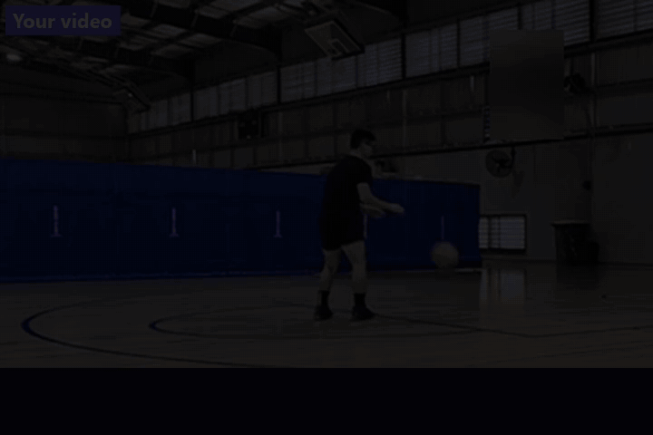
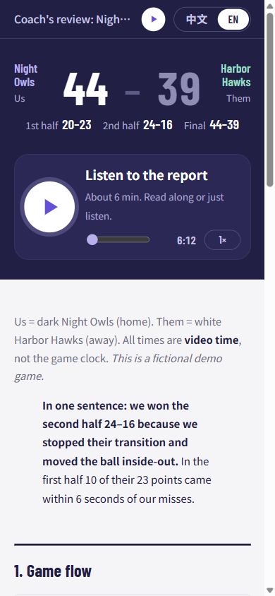

<div align="center">

# sports-video-coach

### Turn your coding agent into your sports coach.

**English** · [中文](https://github.com/mariusCNN/sports-video-coach/blob/master/README.zh.md)

For people who already use Claude Code, Codex, Cursor or a similar coding agent, and play or train a sport.
Film yourself on your phone, paste one prompt, and your agent does the rest: what to fix, a drill for it,
the clips that show it, and an explained video.

<a href="https://mariuscnn.github.io/sports-video-coach/#training-example"></a>

**[▶ Watch a real training review (43 s)](https://mariuscnn.github.io/sports-video-coach/#training-example)**<br>
<sub>The author's own session, reviewed by the agent and edited for length. Not a before/after or an accuracy measurement.</sub>

[](https://github.com/mariusCNN/sports-video-coach/releases)
[](https://github.com/mariusCNN/sports-video-coach/actions/workflows/tests.yml)
[](https://github.com/mariusCNN/sports-video-coach/blob/master/LICENSE)

</div>

## Start in one prompt

Paste this into Claude Code, Codex or another coding agent:

```text
Coach me on my sports video: <path to your video>
Clone https://github.com/mariusCNN/sports-video-coach and follow its START.md.
```

Your agent clones the repo and follows [START.md](START.md):

- It shows you every install command and waits for your OK.
- It asks its questions in one message (sport, who to watch, what you want to improve).
- It reviews your video until the coaching page and the explained video are ready.
- It offers a plan for your next practice.

<sub>Runs on your computer; your video is not uploaded to an app. The AI step uses your own agent account.</sub>

## Is it for you?

**Probably yes if**

- you already use a coding agent (Claude Code, Codex, Cursor ...);
- you play or train a sport and can film yourself on a phone;
- you want a coach's read: what went wrong, why, one drill, what to check next time.

**Probably not if**

- you have never used a coding agent: this is not an app, there is no sign-up and no UI;
- you cannot install [uv](https://docs.astral.sh/uv/) and ffmpeg on your machine;
- you want it to cost nothing: each run uses some of your agent plan (a 40-second clip took about 3 minutes and
  5 agent steps in one of our runs; a full game takes more);
- you need a finished product: it is early (alpha), built and tested by its author on their own games and training.

## Why I built this

I play basketball in an adult rec league. For a long time I trained the same way and didn't get better.
A private coach costs a lot, and most classes are for kids.

I already used a coding agent at work, so I taught it to watch my film the way a coach would: what went wrong
and why, one drill to fix it, and what to check next time. It is free, open source, and works for other sports too.

## Install

The one prompt above does all of this for you. To set it up yourself:

- **Claude Code plugin:** `/plugin marketplace add mariusCNN/sports-video-coach`, then
  `/plugin install sports-video-coach@sports-video-coach`.
- **Any Agent Skills client** (Codex, Cursor ...): `npx skills add mariusCNN/sports-video-coach`.
- **Gemini CLI:** `gemini extensions install https://github.com/mariusCNN/sports-video-coach --ref v0.4.0`
  (manifest new in 0.4.0, not yet tested by the author).
- **The CLI the skill drives** (needs ffmpeg on PATH; about 165 MB, no GPU):

  ```bash
  uv tool install git+https://github.com/mariusCNN/sports-video-coach@v0.4.0
  ```

**Try it in a minute, no video or agent needed:** `sports-video-coach demo` renders a drawn drill end to end.
Or just look: the [demo coaching page](https://mariuscnn.github.io/sports-video-coach/demo/) and its
[explained video](https://mariuscnn.github.io/sports-video-coach/film.en.mp4).

`command not found` after the install: `uv tool update-shell` and a new terminal.

## What you get



- **A coaching page for your phone:** each fix with a drill, a target for next time and the clips that show it.
- **A spoken version** of the report.
- **An explained video:** the clip pauses where it goes wrong, a ring marks the spot, a subtitle says why.
- **The film review behind it:** timed moments, what happened and why, as json.
- **Eight languages:** Chinese, English, Japanese, Korean, Spanish, French, German, Portuguese
  (`--lang`; the basketball plugin: Chinese and English).

**Limits**

- The agent reviews frame sheets (one frame every 0.5 s up to 30 s of video, every second up to 3 minutes,
  every 2 s beyond). Very fast details can fall between frames unless it cuts a denser sheet of that moment.
- What your agent reads (frame sheets, reports) goes to its model provider; narration text goes to an online
  text-to-speech service (`--artifacts html` skips it). Pages show real people: share them only with the people
  in them. Details: [docs/privacy.md](https://github.com/mariusCNN/sports-video-coach/blob/master/docs/privacy.md).

<br clear="right">

## Any sport

| Plugin | For |
|---|---|
| `generic` (built in) | any sport: running, the gym, HYROX, soccer, tennis, basketball from a phone ...; the agent reviews the film |
| `fitness` | gym and strength sessions: sets named from an exercise library, per-rep depth, trunk lean and tempo from pose ([docs](https://github.com/mariusCNN/sports-video-coach/blob/master/docs/fitness.md)) |
| `basketball` | team and player pages, player and ball tracking, shot charts ([docs](https://github.com/mariusCNN/sports-video-coach/blob/master/docs/basketball.md)) |
| yours | `sports-video-coach new-plugin <your-sport>` writes a working plugin to start from ([guide](https://github.com/mariusCNN/sports-video-coach/blob/master/docs/plugins.md)) |

**Basketball, plainly:** the league-link route works for Glory League games only today. A pickup game, a phone
clip or any other league: `sports-video-coach run <video> --sport basketball` (the generic plugin).

## For developers

- [How it works](https://github.com/mariusCNN/sports-video-coach/blob/master/docs/architecture.md): a resumable CLI that stops with exit code 3 whenever it needs the agent's
  eyes or words, checks each agent step, and redoes only what a change made stale. Agent contract: [AGENTS.md](https://github.com/mariusCNN/sports-video-coach/blob/master/AGENTS.md).
- [Feature and command catalog](https://github.com/mariusCNN/sports-video-coach/blob/master/docs/features.md): every capability, its requirements and limits.
- [Benchmark](https://github.com/mariusCNN/sports-video-coach/blob/master/docs/benchmark.md): which agent reads sports film best, scored against exact ground truth;
  [rerun it in the browser](https://github.com/mariusCNN/sports-video-coach/blob/master/docs/benchmark.md#rerun-it-in-the-browser) with
  [Codespaces](https://codespaces.new/mariusCNN/sports-video-coach), or
  [send a row for another agent (issue #7)](https://github.com/mariusCNN/sports-video-coach/issues/7).
- [Basketball perception](https://github.com/mariusCNN/sports-video-coach/blob/master/docs/perception.md): optional, experimental tracking adapters and their measured limits.
- [Coaching knowledge base](https://github.com/mariusCNN/sports-video-coach/blob/master/docs/knowledge-base.md): four basketball KBs with 58 entries, each citing its source;
  add your sport's with a [coaching knowledge issue](https://github.com/mariusCNN/sports-video-coach/issues/new?template=coaching_knowledge.yml) (no code needed).
- [Write a plugin](https://github.com/mariusCNN/sports-video-coach/blob/master/docs/plugins.md) · [Contributing](https://github.com/mariusCNN/sports-video-coach/blob/master/CONTRIBUTING.md) · [Changelog](https://github.com/mariusCNN/sports-video-coach/blob/master/CHANGELOG.md) · [Agent index](https://github.com/mariusCNN/sports-video-coach/blob/master/llms.txt)

Never attach real players' videos, frames or names to issues or pull requests.

## Support

If it helped your game, a ☆ star is how I know, and it helps other players find it.

[MIT](https://github.com/mariusCNN/sports-video-coach/blob/master/LICENSE). Models downloaded at run time keep their own licences.
