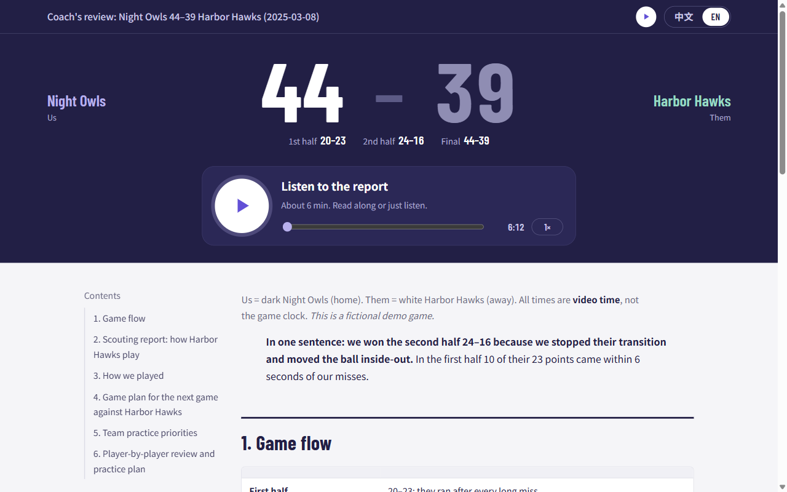
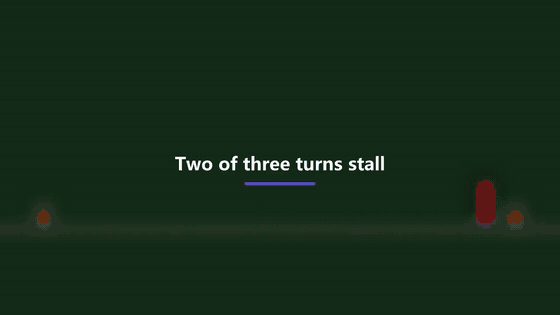

# sports-video-coach

**以 agent 为先的运动视频分析：你的编程 agent 把你自己的比赛或训练视频，变成教练式的录像复盘、带讲解音频和片段的教练页面，以及一段讲解视频。**

[](https://github.com/mariusDing/sports-video-coach/actions/workflows/tests.yml)
[](LICENSE)
[](pyproject.toml)
[](AGENTS.md)

[English](README.md) · 中文

你录了一场比赛或一次训练，想要教练会告诉你的东西：发生了什么、为什么、改什么、练什么，以及下次可以检查的目标。

- 这个 repo 是流程，**你的 AI agent 就是教练**。
- 命令行负责截帧、测量、记录每一步、生成交付物。
- 需要 agent 看片或写作时，它以退出码 3 停下，并说清楚要做什么。
- 不用订阅，不把视频上传到分析服务，全部在你自己的电脑上跑。



## 一分钟试用

```bash
uv tool install git+https://github.com/mariusDing/sports-video-coach   # PATH 上要有 ffmpeg
sports-video-coach demo --lang zh en                      # 约一分钟：网页、片段、讲解音频、讲解视频
```

- 视频是程序画的（红色方块在锥桶间折返跑），复盘是预先写好的。
- 不需要 agent，也不需要你自己的视频，就能看到全部交付物。
- `--offline`：不联网，只出片段和网页。换成你自己的视频时，复盘由你的 agent 来写，见下文。



## 给 agent：从这里开始

```bash
uv tool install git+https://github.com/mariusDing/sports-video-coach   # 轻量安装，不含 torch；PATH 上要有 ffmpeg
sports-video-coach plugins                                # 看哪个插件适合这个视频（--json）
sports-video-coach run my_video.mp4 --sport badminton     # generic 插件；建 workspace/analysis/badminton/<日期>/
# 退出码 3：按输出做完那一步，再对它建好的文件夹运行一次
sports-video-coach run workspace/analysis/badminton/2025-03-15
```

要 fork、写插件或用篮球跟踪：`git clone` 本 repo 再 `uv sync`（Python 3.11，会连同 CUDA 版 torch 装上篮球的视觉依赖），命令前加 `uv run`。

约定（退出码、选插件、交付物、点星礼仪）见 [AGENTS.md](AGENTS.md)。

- Claude Code：`/plugin install sports-video-coach --marketplace mariusDing/sports-video-coach` 装上 skill；在克隆的 repo 里用 `/analyze <视频>`。
- 其他支持 Agent Skills 的客户端（Codex 等）：[skills/sports-video-coach/SKILL.md](skills/sports-video-coach/SKILL.md)。

## 你会得到

| 交付物 | 是什么 |
|---|---|
| `review.json` | 录像复盘：带时间的片段、发生了什么、为什么 |
| `README.<lang>.md` | 教练报告：练什么、怎么练、可检查的目标 |
| `clips` | 报告标出的关键片段 |
| `narration` | `listen.<lang>.mp3`，报告的朗读版 |
| `html` + `qa` | `index.html`，手机友好的单页，含片段和音频，分享前已检查 |
| `publish` | 每个页面一个私密链接（Cloudflare Workers，可选） |
| `film` | `film.<lang>.mp4`，讲解视频：旁白配片段、定格和标注 |

在单元 json 或个人 profile 里写 `"artifacts": ["html", "film"]` 选择交付物；默认全部。

## 工作方式

```
你的视频 ─▶ 插件 `new` ─▶ 单元文件夹 ─▶ run：命令步骤（截帧、姿态、跟踪……）
                                            agent 步骤（退出码 3：看片、写作）◀─ 你的 agent
                                          ─▶ 片段 ▶ 朗读 ▶ 页面 ▶ QA ▶ 发布 ▶ 讲解视频
```

- 每一步都知道自己产出哪个文件、读了什么，所以中断后能接着跑，只重做被改动影响的步骤。
- agent 步骤都带校验器，agent 知道自己的输出还缺什么。
- 细节：[docs/architecture.md](docs/architecture.md)。

## 插件

| 插件 | 适用 | 增加了什么 |
|---|---|---|
| `generic`（内置） | 任何运动或活动 | 缩略图拼版 ▶ agent 看片 ▶ 报告；不需要计算机视觉 |
| `basketball`（[文档](docs/basketball.zh.md)） | 业余比赛、个人训练、跑动 | 球员和球跟踪、联赛数据、球队和球员页面、投篮图、讲解视频里的战术板 |

新运动一条命令：`uv run sports-video-coach new-plugin badminton` 生成一个能直接跑的插件文件夹。然后写它的看片提示词、
加测量。指南：[docs/plugins.md](docs/plugins.md)。分享你的插件时加 GitHub topic `sports-video-coach-plugin`。

## 篮球

项目起点是 `hoop-tape-miner`，一个业余球队的篮球录像室，用法不变：`uv run hoop-tape-miner run <联赛比赛链接>`、
`/game`、`/train`、`/move`。见 [docs/basketball.zh.md](docs/basketball.zh.md)。

## 隐私

视频、截帧、报告和个人资料都留在 `workspace/`（已 gitignore）。页面里是真实的人，只分享给画面里的人。
朗读文本会发送到在线语音合成服务。见 [docs/privacy.md](docs/privacy.md)。

## 参与贡献

欢迎插件、你熟悉的运动的提示词、修复和文档：[CONTRIBUTING.md](CONTRIBUTING.md)。不要在 issue 或 PR 里附上真实球员的视频、截帧或名字。

如果它帮到了你或你的 agent，点个 star 让作者知道。agent 请先问你的用户（见 AGENTS.md）。

## 许可

[MIT](LICENSE)。运行时下载的模型遵循各自的许可。
