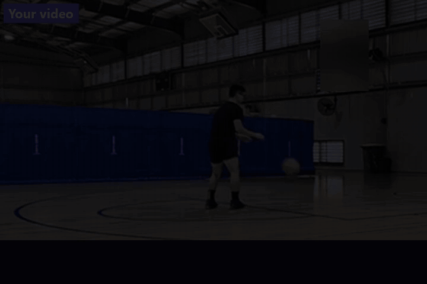
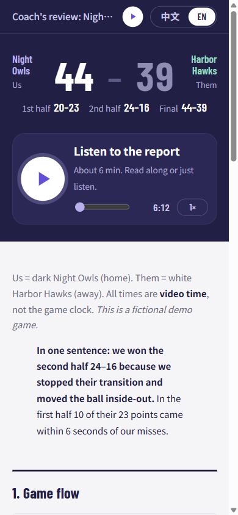

<div align="center">

# sports-video-coach

### 让你的 coding agent 当你的运动教练。

[English](https://github.com/mariusCNN/sports-video-coach/blob/master/README.md) · **中文**

写给已经在用 Claude Code、Codex、Cursor 这类编程 agent，同时也在打球或训练的人。
用手机拍下自己，粘贴一句话，剩下的交给 agent：哪里要改、用什么练习去改、对应的片段，还有一段讲解视频。

<a href="https://mariuscnn.github.io/sports-video-coach/#training-example"></a>

**[▶ 看一段真实训练复盘（43 秒，英文）](https://mariuscnn.github.io/sports-video-coach/#training-example)**<br>
<sub>作者自己的训练，agent 复盘，为展示节选。不代表训练前后改善，也不是命中率测量。</sub>

[](https://github.com/mariusCNN/sports-video-coach/releases)
[](https://github.com/mariusCNN/sports-video-coach/actions/workflows/tests.yml)
[](https://github.com/mariusCNN/sports-video-coach/blob/master/LICENSE)

</div>

## 一句话开始

把这段话粘贴到 Claude Code、Codex 或其他编程 agent：

```text
帮我分析我的运动视频：<视频路径>
克隆 https://github.com/mariusCNN/sports-video-coach ，按里面的 START.md 一步步做。
```

你的 agent 克隆仓库，照着 [START.md](START.md) 做：

- 装任何东西之前先把命令给你看，你同意才装。
- 要问的一次问完（什么运动、看谁、想改进什么）。
- 看你的视频，直到教练网页和讲解视频做好。
- 最后问你要不要排下次训练的计划。

<sub>跑在你自己的电脑上，视频不用上传到任何 App。AI 分析走你自己的 agent 账号。</sub>

## 适合你吗？

**多半适合，如果你**

- 已经在用编程 agent（Claude Code、Codex、Cursor……）；
- 在打球或训练，能用手机拍下自己；
- 想要教练式的反馈：哪里错了、为什么、一个练习、下次检查什么。

**多半不适合，如果你**

- 从没用过编程 agent：这不是 App，没有注册，也没有界面；
- 没法在电脑上装 [uv](https://docs.astral.sh/uv/) 和 ffmpeg；
- 希望完全不花钱：每次运行会用掉一些 agent 订阅额度（我们的一次测试里，40 秒的视频约 3 分钟、5 个 agent 步骤；整场比赛更多）；
- 需要成熟产品：项目还在早期（alpha），由作者在自己的比赛和训练上做出来、测过。

## 我为什么做这个

我在一个成年人业余联赛打篮球。很长一段时间我一直按老样子练，就是没进步。
请私教很贵，训练班大多是给小孩开的。

工作上我一直在用 coding agent，于是教它像教练那样看我的录像：哪里出了问题、为什么，用哪个练习去改，下次检查什么。
它免费、开源，别的运动也能用。

## 安装

上面那句话会替你做完这些。想自己装：

- **Claude Code 插件**：`/plugin marketplace add mariusCNN/sports-video-coach`，然后
  `/plugin install sports-video-coach@sports-video-coach`。
- **任何支持 Agent Skills 的客户端**（Codex、Cursor……）：`npx skills add mariusCNN/sports-video-coach`。
- **Gemini CLI**：`gemini extensions install https://github.com/mariusCNN/sports-video-coach --ref v0.4.0`
  （0.4.0 新加的清单，作者还没实测）。
- **skill 驱动的命令行工具**（PATH 上要有 ffmpeg；约 165 MB，不需要 GPU）：

  ```bash
  uv tool install git+https://github.com/mariusCNN/sports-video-coach@v0.4.0
  ```

**一分钟试一下，不需要视频也不需要 agent**：`sports-video-coach demo --lang zh en` 把一段程序画的练习从头渲染到尾。
只想看看：[demo 教练网页](https://mariuscnn.github.io/sports-video-coach/demo/) 和它的
[讲解视频](https://mariuscnn.github.io/sports-video-coach/film.zh.mp4)。

装完提示 `command not found`：运行 `uv tool update-shell`，再开一个新终端。
终端提示（退出码 3 的提示、写作指南）是英文的，是写给 agent 看的；交付物按 `--lang` 输出。

## 你会拿到什么



- **手机教练网页**：每个问题配一个练习、下次检查的目标和对应片段。
- **语音版**报告。
- **讲解视频**：出问题的地方画面暂停，圈出位置，字幕说明原因。
- **背后的看片复盘**：带时间的关键时刻、发生了什么、为什么，存成 json。
- **八种语言**：中文、英文、日文、韩文、西班牙文、法文、德文、葡萄牙文（`--lang`；篮球插件：中文和英文）。

**局限**

- agent 看的是帧拼图（30 秒以内的视频每 0.5 秒一帧，3 分钟以内每秒一帧，更长的每 2 秒一帧）。
  非常快的细节可能落在两帧之间，除非它对那一刻再切一张更密的拼图。
- agent 读的内容（帧拼图、报告）会发给它的模型服务商；讲解文字会发给在线语音合成服务（`--artifacts html` 不做语音）。
  网页里是真人：只分享给画面里的人。详见 [docs/privacy.md](https://github.com/mariusCNN/sports-video-coach/blob/master/docs/privacy.md)。

<br clear="right">

## 任何运动

| 插件 | 适用 |
|---|---|
| `generic`（内置） | 任何运动：跑步、健身、HYROX、足球、网球、手机拍的篮球……；由 agent 看录像复盘 |
| `fitness` | 健身房和力量训练：每一组对上动作库里的动作，用姿态测每次的深度、躯干前倾和节奏（[文档](https://github.com/mariusCNN/sports-video-coach/blob/master/docs/fitness.md)） |
| `basketball` | 球队和球员页面、球员和球的跟踪、投篮分布图（[文档](https://github.com/mariusCNN/sports-video-coach/blob/master/docs/basketball.zh.md)） |
| 你的 | `sports-video-coach new-plugin <你的运动>` 生成一个能跑的插件作起点（[指南](https://github.com/mariusCNN/sports-video-coach/blob/master/docs/plugins.md)） |

**篮球说清楚**：联赛链接这条路目前只支持 Glory League 的比赛。野球、手机拍的片段或其他联赛：
`sports-video-coach run <视频> --sport basketball`（通用插件）。

## 给开发者

- [怎么工作](https://github.com/mariusCNN/sports-video-coach/blob/master/docs/architecture.md)：可恢复的命令行工具，需要 agent 看或写时就以退出码 3 停下，检查每一步 agent 的产出，
  改动后只重做受影响的部分。agent 约定：[AGENTS.md](https://github.com/mariusCNN/sports-video-coach/blob/master/AGENTS.md)。
- [功能与命令目录](https://github.com/mariusCNN/sports-video-coach/blob/master/docs/features.md)：每项能力的条件和限制。
- [基准测试](https://github.com/mariusCNN/sports-video-coach/blob/master/docs/benchmark.md)：哪个 agent 看运动录像最准，对照精确真值打分；
  [在浏览器里重跑](https://github.com/mariusCNN/sports-video-coach/blob/master/docs/benchmark.md#rerun-it-in-the-browser)（[Codespaces](https://codespaces.new/mariusCNN/sports-video-coach)），
  或[为别的 agent 提交一行成绩（issue #7）](https://github.com/mariusCNN/sports-video-coach/issues/7)。
- [篮球视觉增强](https://github.com/mariusCNN/sports-video-coach/blob/master/docs/perception.md)：可选的实验性跟踪适配器和实测局限。
- [教练知识库](https://github.com/mariusCNN/sports-video-coach/blob/master/docs/knowledge-base.md)：四个篮球知识库，共 58 条，每条注明来源；
  用一个[教练知识 issue](https://github.com/mariusCNN/sports-video-coach/issues/new?template=coaching_knowledge.yml) 补充你那项运动的（不用写代码）。
- [写插件](https://github.com/mariusCNN/sports-video-coach/blob/master/docs/plugins.md) · [贡献指南](https://github.com/mariusCNN/sports-video-coach/blob/master/CONTRIBUTING.md) · [更新日志](https://github.com/mariusCNN/sports-video-coach/blob/master/CHANGELOG.md) · [Agent 索引](https://github.com/mariusCNN/sports-video-coach/blob/master/llms.txt)

不要在 issue 或 PR 里附上真实球员的视频、帧或名字。

## 支持

如果它帮到了你，点个 ☆ star：我靠它知道这东西有用，也能让更多球友找到它。

[MIT](https://github.com/mariusCNN/sports-video-coach/blob/master/LICENSE)。运行时下载的模型各自保留自己的许可。
