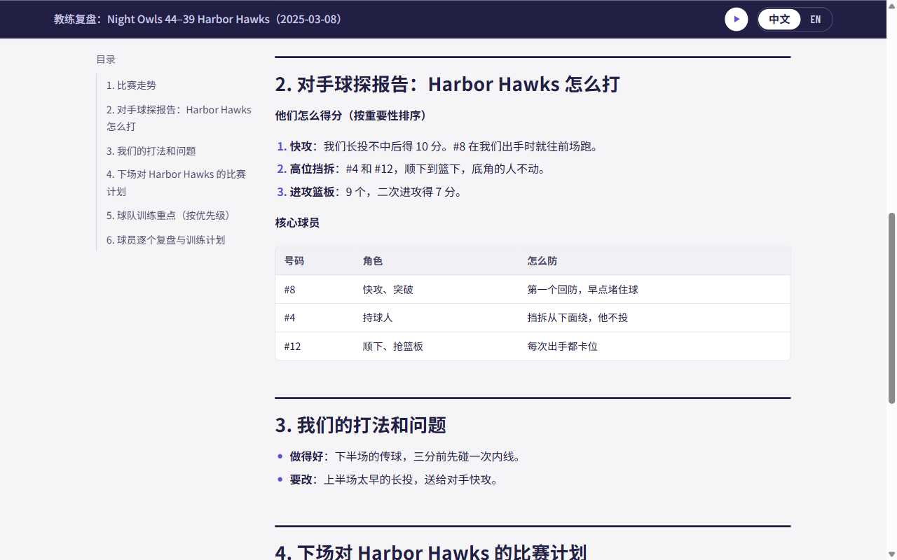
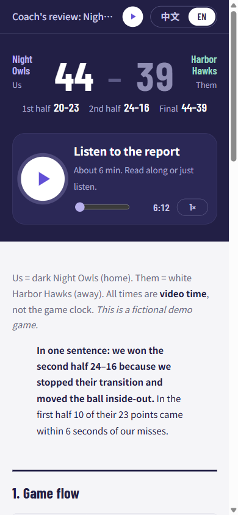

# Basketball plugin (hoop-tape-miner) 🏀

**Mine your basketball game tape for the insights that win the next game.**

[](https://github.com/mariusDing/sports-video-coach/actions/workflows/tests.yml)
[](../LICENSE)
[](../pyproject.toml)
[](../AGENTS.md)
[](https://github.com/mariusDing/sports-video-coach/issues?q=is%3Aopen+label%3A%22good+first+issue%22)

English · [中文](basketball.zh.md)

> The basketball plugin of [sports-video-coach](../README.md), and the project it grew from. Its CLI is still `hoop-tape-miner`.

AI basketball video analysis for amateur and club teams. Paste the link of your game and get back what a coach would give you: what happened, why you won or lost, what the opponent did and what to work on next. You get it as a page to read or listen to, and as a video that explains it over the plays.

Your AI coding agent ([Claude Code](https://claude.com/claude-code) or [Codex](https://openai.com/codex)) runs the computer-vision pipeline in this repo on your own GPU, reviews the film like a coach, and writes everything. No subscription, no upload of your video to a sports-analytics service.

**Who it's for**

- Amateur, club and rec-league teams that film their games but never have time to study the tape.
- Captains and volunteer coaches who want a scouting report on the opponent before the rematch.
- Developers who want a working basketball computer-vision and AI-agent film-review pipeline to fork and build on.


## What you get

Two things per game:

1. **Pages, shared as links**: a team page and a page for one focus player, each in English and Chinese (switch on the page).
   - Team page: how the game went, the opponent's key players and habits, what worked and what didn't, a game plan for the rematch, a practice plan, and a review of every player with two drills each.
   - Player page: a deep dive for one player, sent only to them.
   - A big play button for the **narration** of each page, for teammates who would rather listen on the way to practice.
   - **Film clips right next to the analysis** (with slow motion), and a score-margin chart with the scoring runs.
   - Each page keeps one stable, unlisted link (free on Cloudflare). Publish again after an edit and the link you already sent shows the new version.
2. **An explained video** per language: the narration plays over the key plays and charts it talks about, with freeze frames that ring the players and subtitles burned in. It is a normal MP4 that you send yourself; it is never uploaded anywhere.

Every claim points to a video time, so the team can watch the moment while discussing what to change.

| Bilingual report | On a phone |
|---|---|
|  |  |

*Screenshots are from a fictional demo game.*

The code can also make an opponent dossier, on-court cue loops, a tactics-board replay, shot-zone charts and a single offline HTML file. These are optional extras (see the [playbook](playbook.md#optional-extras)).

## How it works

```
league link ──► fetch ──────────────► computer vision (GPU, ~1 h) ──► film review ──► pages, narration ──► links
                video, box score,     players, ball, court,           by AI agents     clips                + explained video
                score flow, rosters   teams, jersey numbers
```

1. **Fetch:** the agent reads the game from the league site (teams, rosters, score, box score, the score after every basket) and downloads the game video.
2. **Computer vision:** detects players and the ball in every frame, maps them onto the court, splits the two teams by jersey colour, reads jersey numbers, and works out lineups and possessions. The agent calibrates the court itself by reading frames with a grid drawn on them; nobody has to click points.
3. **Film review:** the game is cut into annotated frame sheets. Subagents go through them with a coach's checklist covering transition defence, ball pressure, shot selection and more. Every possession they log is checked against a fixed schema (who shot, made or missed, which foul, with video times), and the shots and fouls are scored against the league's box score, so wrong facts show up before anything is written.
4. **Facts first, then coaching:** reviews are merged into fact sheets (plus-minus, stints, patterns, clips), plus numbers measured from the tracking for each possession (players back on defence two seconds in, spacing, standing still). A writer agent turns patterns seen on at least two possessions into coaching insights: what happened, **why** (from a coaching knowledge base paraphrased from the FIBA and Jr. NBA coaching manuals, with page references), one rule, one drill and a measurable target for the next game. A critic agent re-opens the film for every insight and drops what it cannot see. The pages are written from those, using the guides in [`prompts/`](../prompts/).
5. **Render and share:** narration (Microsoft Edge neural voices), clips of the key plays, the HTML pages (published as links) and the explained video.

One command drives all of it: `hoop-tape-miner run`. It knows which file each step produces, so it resumes where it stopped and only pauses where the agent has to look or write. Full details: [docs/pipeline.md](pipeline.md).

## Quick start

### 1. Requirements

- An **NVIDIA GPU** with 8 GB or more of VRAM, on Windows or Linux. The jersey reader needs CUDA.
- [uv](https://docs.astral.sh/uv/), Python 3.11, and `ffmpeg` on your PATH. Node.js for publishing and the page checks.
- About 20 GB of disk for the models. They download on first use.
- Claude Code or Codex. The film review and the writing are agent work.
- A game filmed by one camera on the side of the court: a league video (link) or your own recording.

### 2. Install

```bash
git clone https://github.com/mariusDing/sports-video-coach.git    # or your fork
cd sports-video-coach
git checkout 934030b9f05f3b65f4d690b6f1cc7eb953119c7f
uv sync
uv run hoop-tape-miner          # lists every stage
```

### 3. Tell it who you are (once)

```bash
mkdir -p workspace && cp templates/team.example.json workspace/team.json
```

Fill in your team's name as the league shows it, your jersey colour, the focus player's number, the report languages, and the path of a secrets file **outside the repo** with your league login (`GLORY_EMAIL=...` and `GLORY_PASSWORD=...` on two lines). Everything in `workspace/` stays on your machine and is never committed.

For the links, create a free Cloudflare account and run `npx wrangler login` once.

### 4. After each game, paste the link

In Claude Code, inside the repo:

```
/game https://my.gloryleague.basketball/game/<id>/overview
```

In Codex (or any agent), say: *"Here is our game: `<link>`. Run it following AGENTS.md."*

The agent runs `uv run hoop-tape-miner run <link>` and does the steps that need eyes: court points, which jersey colour is which team, the film review, the writing, and a browser check of the pages. It then publishes the pages and replies with the links and the paths of the two videos. Expect about an hour on the GPU plus the agent's work.

**Another league, or no league?** Start from your own video instead: `uv run hoop-tape-miner new-game --opponent "Red Foxes" --date 2025-03-08 --video game.mp4 --us-team "Night Owls"`, fill `game.json`, then `run` that folder. The box score and score flow are optional: convert your league's data to the `official.json` shape (see [playbook step 6](playbook.md#6-official-stats-and-result)), or let the report rest on the film review alone. A `fetch` for another league site is a welcome contribution.

### 5. Share

- Pages: send the team the hub link (new games appear on it) or the team page link; send the player page only to that player. Links are unlisted, not password-protected.
- Explained video: send `film.zh.mp4` / `film.en.mp4` in your team chat.
- Clips and videos show real players: share them with the team only (see [docs/privacy.md](privacy.md)).

## Personal training

Film your own workout (shooting, finishing, dribbling) on a phone and get the same kind of page and explained video for it, plus a plan for next time whose targets the next session checks: `/train <videos> --plan "free throws, left-hand layups"` in Claude Code, or `uv run hoop-tape-miner train <videos> --player 7`. Pose (YOLO) finds every shot, finish and dribble block and measures knee bend, elbow angles and release timing; agents judge make or miss from rim filmstrips; the page shows percentages by zone and finish type, form for makes vs misses, and progress across sessions. Put the phone on a tripod with the rim and your whole body in frame, side-on or from behind. Training pages get their own private link and are never listed on the team hub. Details: [playbook](playbook.md#personal-training-sessions).

## Training program app

A month of training as one phone page you follow every day: today's session opens by date, each exercise has a how-to, coach tips and YouTube demos, you tick sets and log weights or makes, and game days have a game plan and a quick stat log. The calendar shows every week as a grid of coloured session badges. Write the program as `program.json` (schema: [templates/program.example.json](../templates/program.example.json)) in `workspace/players/<player>/program/<start date>/`, then `uv run hoop-tape-miner program build <folder>` (a local `index.html`) or `publish <folder> --deploy` (a private `/p/<token>/` link). Opened from that link, the log syncs to the site (Workers KV, newest copy wins), so it follows you to another phone, and `program pull <folder>` saves it as `progress.json` for an agent to analyse and write next month's program. Details: [playbook](playbook.md#training-program-app).

## Movement: running form, force pattern, layups

Clip windows of any video (side-view phone sprints in slow motion work best; training and game footage too) and get a sprint-and-movement coach's page and explained video on how you run, finish layups and stop, plus a training, fuel and recovery plan: `/move <segments.json>` in Claude Code, or `uv run hoop-tape-miner move --spec segments.json --player 7`. Pose at native frame rate measures trunk lean, shin angle, foot strike, contact time and cadence from side views (shown only after a hand-labelled contact check); agents judge every view against a movement knowledge base (`prompts/movement_kb.md`) and say what the footage cannot show. Details: [playbook](playbook.md#movement-sessions).

## Commands

| Stage | What it does |
|---|---|
| `run` | one game end to end: every stage below in order, resuming, pausing where the agent must judge (`--status`, `--publish`) |
| `fetch` | league game link → `game.json`, box score and score flow, game video |
| `new-game` | create a game folder and `game.json` by hand (no league data) |
| `calibrate` | court calibration: `--grid` writes frames to read, `--points` solves and checks them |
| `extract` → `embed` → `tracks` → `jersey` | computer vision: detections, team split, tracking, jersey numbers |
| `analyze` | identities, possessions, tactical metrics |
| `coach-sheets` → `coach-summary`, `plusminus` | film-review sheets (also fact-check sheets around each official score and foul), and the numbers from the agents' reviews |
| `coach-check` | validate the film review against the possession schema and check every possession is covered (`--migrate` converts old reviews) |
| `coach-features` | per-possession numbers from the court tracks: players back, spacing, paint crowd, standing still |
| `coach-insights` | check the coaching insights (cited trips, knowledge-base entries, numbers, the critic's signed `critic.json`); `critic` signs the critic's verdicts; `ab` builds a blind A/B rating sheet |
| `coach-eval` | score a film review against the league box score (with a pass/fail gate and a warning when it got worse) and lint the coaching advice for evidence, reasons, drills and targets |
| `momentum` | score-margin chart with scoring runs |
| `clips` | cut the film clips a report marks (``) |
| `narrate` | narration script → MP3; also on-court cue loops (`--chime --gap`, `--tight` for exact pauses) |
| `html` | report folder → one bilingual HTML page |
| `publish` | pages → private-link website on Cloudflare, one stable link per report |
| `season` | every game → season page (results, Four Factors trends, targets checked, pooled on / off with shrinkage) and a pre-game listen script (`--brief`) |
| `film` | explained video: narration over clips, freeze frames, court diagrams and charts, with subtitles |
| `train` | one personal training session: phone videos → session page, explained video, next session's plan (`train-new`, `train-scan`, `train-sheets`, `train-summary` are its stages) |
| `program` | training-plan app: `build` the page from `program.json`, `check` it, `pull` the progress synced from its link |
| `move` | one movement session: clip windows → movement page, explained video, training / fuel / recovery plan (`move-new`, `move-scan`, `move-sheets`, `move-summary` are its stages) |
| `official`, `recalib`, `report`, `replay`, `review`, `merge-reviews` | optional: league JSON import, re-run court mapping, CV figures, tactics-board replay, event review |

Run `uv run hoop-tape-miner <stage> -h` for the options of each stage.

## Project layout

```
.claude/commands/game.md   the /game command for Claude Code
AGENTS.md                  instructions for any agent (CLAUDE.md points here)
docs/playbook.md           the procedure the agent follows, link → pages + video
prompts/                   writing guides (film review brief, insights writer and critic, coach report, player
                           deep dive, narration, explained video, training) and the coaching knowledge base
                           (coach_kb.md)
templates/                 team.json, game.json, program.json and opponent dossier skeletons
src/hoop_tape_miner/       the pipeline (one module per stage; run.py drives them)
workspace/                 YOUR data: team profile, games, reports (gitignored)
```

## FAQ

**Does it need the internet?** The models download once. After that the vision and analysis run locally. Fetching reads your league's site, narration sends the script text (not the video) to Microsoft's text-to-speech service, and publishing uploads the pages, audio and clips (not the full video) to your Cloudflare account. Your agent runs on whichever service you use it with.

**Can I run it without a GPU, or on a Mac?** Not yet. Detection falls back to CPU, but that is very slow, and the jersey reader needs CUDA.

**My league has no box score, or isn't Glory League.** That's fine. Start with `new-game`, put the final score in `game.json`, and the report is built from the film review alone. If your league publishes data, convert it to the `official.json` shape, or add a `fetch` for it.

**How accurate is it?** The vision gives positions and possessions. The judgement comes from the film review, which flags anything uncertain (an unreadable jersey, for example) as "likely". `coach-eval` scores each review against the league box score (points and fouls per player), so you can see how far to trust it; jerseys a few pixels tall are the main source of wrong shooters. Check the clips it points to before you act on them.

**Where does the coaching advice come from?** From [`prompts/coach_kb.md`](../prompts/coach_kb.md): one entry per common amateur problem (transition defence, press break, spacing, help defence, closeouts, rebounding, fouls, shot selection, pick-and-roll, late clock), each paraphrased from the free FIBA WABC and Jr. NBA coaching manuals with page references. Rules and numbers the manuals don't give are labelled as the team's own choices and trial values. Every insight must cite an entry, and the critic checks it against the film.

**Which languages?** The pages, narration and video come in English and Chinese, or just one of them: set `languages` in `workspace/team.json` (default `["zh", "en"]`).

**Privacy.** The reports name players and show frames of real people. Read [docs/privacy.md](privacy.md) before sharing, especially if minors play in your league.

## Status and roadmap

Working end to end on real games (one side-on camera, NVIDIA GPU). Known limits and what's next:

- [ ] Run without CUDA (CPU or Apple Silicon jersey reader)
- [ ] A synthetic demo game anyone can run, with no real players in it
- [ ] `fetch` for more leagues (today: Glory League, see [`fetch.py`](../src/hoop_tape_miner/fetch.py))
- [ ] More report and narration languages beyond English and Chinese
- [ ] Better handling of panning or phone-recorded video

Ideas and votes are welcome in [Discussions](https://github.com/mariusDing/sports-video-coach/discussions).

## Contributing

Contributions are welcome, from a typo fix to a new league fetcher. Start with [CONTRIBUTING.md](../CONTRIBUTING.md) and the [good first issues](https://github.com/mariusDing/sports-video-coach/issues?q=is%3Aopen+label%3A%22good+first+issue%22). Ask questions in [Discussions](https://github.com/mariusDing/sports-video-coach/discussions).

One hard rule: never attach game videos, frames, rosters or names of real players to issues or pull requests. See [docs/privacy.md](privacy.md).

Please follow the [Code of Conduct](../CODE_OF_CONDUCT.md). Report security issues privately as described in [SECURITY.md](../SECURITY.md).

## Acknowledgements

Built on [RF-DETR](https://github.com/roboflow/rf-detr), [supervision](https://github.com/roboflow/supervision) / [trackers](https://github.com/roboflow/trackers), [SigLIP](https://huggingface.co/google/siglip-base-patch16-224), [Qwen3-VL](https://huggingface.co/Qwen), [edge-tts](https://github.com/rany2/edge-tts), and ideas from [basketball_analysis](https://github.com/abdullahtarek/basketball_analysis). See [docs/research.md](research.md).

## License

[MIT](../LICENSE). Models downloaded at run time keep their own licences.

To cite this project, use **Cite this repository** in the GitHub sidebar ([CITATION.cff](../CITATION.cff)).

If this helps your team, a ⭐ helps others find it.
